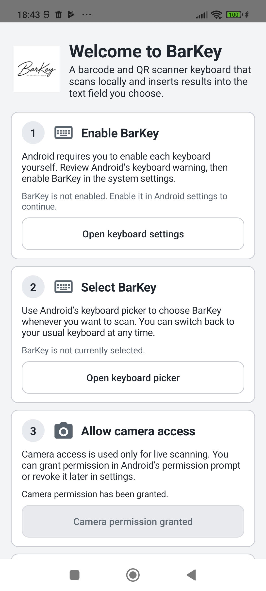
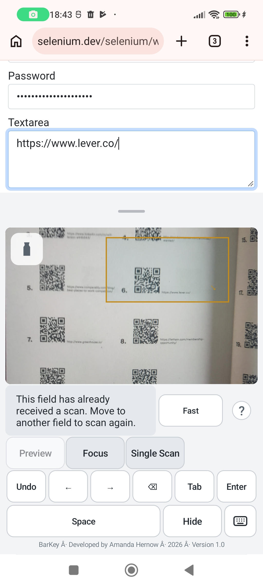
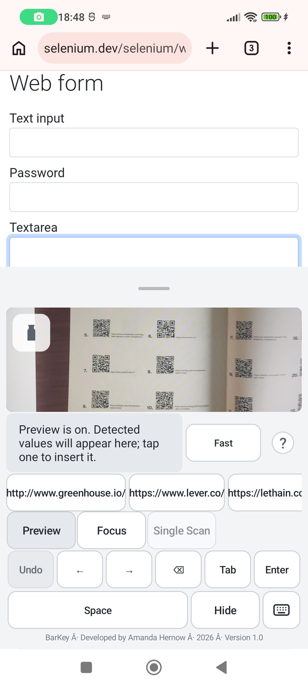

# BarKey

**BarKey is a barcode and QR-code scanning keyboard for Android.** It uses the rear camera to scan a code and enters the result directly into the text field you are using. Scanning and decoding happen on the device, without an internet connection.

BarKey is free for private, personal use. Company and workplace use require my prior written approval; see [Intended use and licence](#intended-use-and-licence).

## Features

- Scans QR codes and a range of one- and two-dimensional barcode formats, including Data Matrix, Aztec, PDF417, EAN, UPC, Code 39, Code 93, Code 128, ITF, Codabar, MaxiCode and GS1 DataBar families. The scanner also supports Micro QR, rMQR and MicroPDF417.
- Inserts a decoded value at the cursor in the active text field.
- Offers **Fast** mode for ordinary scans and **Accurate** mode for difficult, angled or damaged codes. Accurate mode can take longer.
- Lets you tap the camera preview to request focus and exposure at that point. A torch control is available when the camera supports flash.
- Provides **Preview**, **Focus**, **Auto Tab** and **Auto Enter**. Preview lets you choose detected values before insertion. Focus limits scanning to a movable, resizable area. Each automatic-action button cycles through Off, ×1 and ∞; only one can be active. Both work with Focus and are turned off in Preview.
- Automatic scanning allows one successful insertion per field by default. BarKey remembers scanned fields when Android provides a reliable field ID, so returning to a previously scanned field stays protected. Each previously unscanned, reliably identified field has its own allowance. Tap the status message for **Scan Again** when the app does not expose reliable field identity. A safely verified Undo can also rearm scanning when the field is empty.
- Includes **Undo** for up to 20 recent BarKey scans or Space insertions when the current text field can be checked safely. Undo history is held in memory and cleared when BarKey restarts.
- Includes Backspace, Space, Left, Right, Tab and Enter controls, plus options to switch keyboards or hide BarKey.
- Provides portrait and landscape layouts, follows Android’s light or dark appearance, and lets you resize the docked keyboard.
- Includes an in-keyboard **About & Help** panel and a setup guide for enabling BarKey in Android settings.

## Screenshots

<table>
  <tr>
    <th>Setup guide</th>
    <th>Focus scan area (earlier layout)</th>
    <th>Preview suggestions</th>
  </tr>
  <tr>
    <td></td>
    <td></td>
    <td></td>
  </tr>
</table>

## First use

1. Open BarKey and read the personal-use agreement. If you select BarKey as your keyboard before opening the launcher app, the agreement appears when you first use the keyboard.
2. Accept the terms and follow the setup guide to enable and select BarKey in Android settings.
3. Allow camera access when Android asks.
4. Focus a text field, select BarKey from Android’s keyboard picker and point the rear camera at a supported barcode.

Android controls which keyboards are enabled and selected. BarKey does not change these settings for you.

## Using the scanner

- **Fast / Accurate:** Choose the mode that suits the code. Accurate mode searches more thoroughly and may be slower.
- **Preview:** Pause automatic insertion and tap a detected suggestion to insert it. Suggestions are temporary and are not scan history. Selecting candidates never performs Auto Tab or Auto Enter; you can deliberately select multiple suggestions. A successful Preview selection consumes that field’s automatic-scan allowance. BarKey remembers reliably identified fields, so returning to a previously scanned field stays protected; each previously unscanned field has its own allowance. Use Scan Again or a verified empty-field Undo to rearm a used field. An administrator-managed `scan_suffix`, if configured, still follows each successful Preview selection.
- **Focus:** Drag the outlined area over the code. Drag its corner handle to resize it, or long-press Focus to reset it. Keep the whole code and a little clear space inside the outline. Tapping the preview requests autofocus; it does not move the scan area.
- **Auto Tab / Auto Enter:** Each button cycles through Off, ×1 and ∞. ×1 inserts one value, requests Tab or performs Enter, then turns Off. ∞ pauses after every action until a different field in the same app is reliably identified; changing apps ends the automatic-action workflow. Tab only uses the editor's advertised Next action; BarKey does not send Enter when Tab is unsupported. Enter behaviour depends on the host editor and may submit a form.
- **One scan per field:** This protection is always active for automatic scanning. BarKey remembers successfully scanned fields when Android provides reliable field IDs; moving to another field does not rearm a previously scanned one. If an app does not expose stable field identity, tap the status message to Scan Again. Undo rearms only after a safe deletion is verified and the field is empty. With both automatic actions Off, the managed `scan_suffix` setting retains its existing behaviour; an active Auto Tab or Auto Enter replaces that suffix for the scan.
- **Torch:** Turn on the camera light on devices that support it.
- **Resize:** Drag the handle above the camera preview to change the keyboard height. The preview changes size while the editing controls remain usable.

## Keyboard controls

| Control | What it does |
| --- | --- |
| Undo | Reverses recent BarKey scans or Space insertions one at a time when the editor state can be safely verified. Undo is unavailable in private/password fields and some apps may not expose enough information. |
| Backspace | Deletes the selected text or the character before the cursor. Hold to repeat. |
| Space | Inserts a space at the cursor. |
| Left / Right | Requests cursor movement in the current field. The receiving app controls the result. |
| Tab | Requests movement to the next field when the receiving app advertises that action. It does not guarantee focus will move. |
| Enter | Uses the field’s Enter action, inserts a newline in supported multiline fields or sends an Enter key event, depending on the receiving app. |
| Switch Keyboard | Returns to another enabled keyboard or opens Android’s keyboard picker. |
| Hide Keyboard | Dismisses BarKey. |

The app receiving text controls its editor behaviour. Navigation and editing actions can therefore behave differently between apps and fields.

## Android phones, tablets and managed devices

BarKey is designed for Android phones and tablets. It can also be installed on shared or organisation-managed Android devices, including devices enrolled in Microsoft Intune. Android’s camera permission and the requirement to enable and select BarKey as an input method still apply. BarKey includes an Android managed configuration setting, `scan_suffix`, which can add no action, Enter or Tab after a scan; its default is no action.

Being technically installable or configurable on an Intune-enrolled device does **not** grant permission for company or workplace use. The personal-use agreement and source licence still apply. If your organisation wants to install or test BarKey for work, please contact me for written approval first. Managed deployments and organisation-specific policies have not been validated in every environment.

## Privacy

BarKey requests camera access to scan. Camera frames are decoded locally, and scanned values are inserted into the active text field without using the clipboard. The app does not need internet access and does not send camera frames, scans or surrounding text anywhere. It has no advertisements, analytics or tracking, and does not keep permanent scan history. Temporary Preview suggestions, per-field protection IDs and guarded Undo data are held in memory only; the field IDs are cleared when the keyboard service is destroyed.

The app receiving the text controls what it does with that text after insertion. For more detail, read the [Privacy Policy](https://amandahernow.github.io/barkey/privacy-policy.html) or open **About & Help** in the keyboard.

## Intended use and licence

BarKey is free to use for private, personal purposes. Company or workplace use, commercial activity, paid redistribution, or inclusion in a paid product or service requires my prior written approval. Please contact me before installing or testing BarKey for work or evaluation. There is no company trial or free scan allowance.

Contact me at [barkey.support@hernow.net](mailto:barkey.support@hernow.net) to request commercial permission or discuss a commercial version.

The source code is available under the [PolyForm Noncommercial License 1.0.0](LICENSE). This is a source-available licence that restricts commercial use; it is not an OSI-approved open-source licence.

## More information

- [BarKey website](https://amandahernow.github.io/barkey/)
- [About BarKey](https://amandahernow.github.io/barkey/about.html)
- [Privacy Policy](https://amandahernow.github.io/barkey/privacy-policy.html)
- [Support](mailto:barkey.support@hernow.net)
- [Third-party licence notices](NOTICE)

**Copyright © 2026 Amanda Hernow.**
